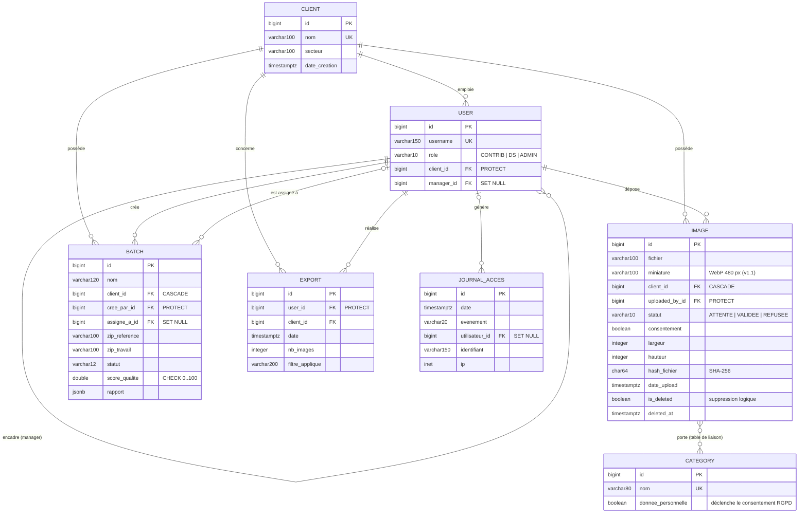

# Schéma de la base de données — PixBank v1.1

Base relationnelle : **PostgreSQL 16** en production (via `DATABASE_URL`),
**SQLite** en développement local. Le schéma est produit par les
migrations Django (`core/migrations/`) et il est identique sur les deux
moteurs. Les 125 tests passent sur les deux (voir [TESTS.md](TESTS.md)).

## 1. Modèle relationnel



Tables annexes, non reliées : `DemandeInscription` (demandes d'accès en
attente de validation) et `MessageContact` (formulaire de contact).

## 2. Choix des types de données

| Donnée | Type PostgreSQL | Justification |
|---|---|---|
| Identifiants | `bigint` | Une banque d'images d'entraînement peut dépasser 2 milliards de lignes de liaison à long terme ; `bigint` évite toute migration future |
| Empreinte SHA-256 | `varchar(64)` | Une empreinte SHA-256 fait toujours 64 caractères hexadécimaux : aucune place perdue |
| Statuts, rôles | `varchar(10)` + liste de choix | Valeurs lisibles en base (`VALIDEE` plutôt que `2`), contrôlées par l'application |
| Dates | `timestamptz` | Horodatage avec fuseau : un export fait à 23 h 30 à Paris reste daté correctement, quel que soit le fuseau du serveur |
| Rapport de contrôle qualité | `jsonb` | Structure variable (une ligne par image), consultée d'un bloc. JSONB est binaire, compact et interrogeable |
| Score qualité | `double precision` + contrainte CHECK | Pourcentage décimal (ex. 91,4), borné entre 0 et 100 par la base |
| Adresse IP | `inet` | Type natif PostgreSQL : valide automatiquement IPv4 et IPv6 |
| Dimensions | `integer` positif | Contrainte `CHECK (largeur >= 0)` générée automatiquement |
| Fichiers | `varchar(100)` (chemin) | Les images restent sur le disque. La base ne stocke que leur chemin, ce qui la garde légère et rapide à sauvegarder |

## 3. Intégrité référentielle : comportement à la suppression

| Lien | Règle | Raison |
|---|---|---|
| Utilisateur → Client | `PROTECT` | Impossible de supprimer une entreprise qui a encore des comptes |
| Image → déposant | `PROTECT` | On ne perd jamais l'auteur d'une donnée personnelle (traçabilité RGPD) |
| Image → Client | `CASCADE` | Fin de contrat : les images du client sont supprimées avec lui |
| Lot → contributeur assigné | `SET NULL` | Le départ d'un contributeur ne supprime pas le lot : il redevient assignable |
| Journal → utilisateur | `SET NULL` | Le journal survit à la suppression d'un compte ; l'identifiant saisi reste lisible |

Test : `test_maintenance.test_client_avec_utilisateurs_non_supprimable`.

## 4. Contraintes et index ajoutés en v1.1

| Nom | Type | Définition |
|---|---|---|
| `image_unique_par_client` | UNIQUE partiel | `(client_id, hash_fichier) WHERE NOT is_deleted` |
| `batch_score_entre_0_et_100` | CHECK | `score_qualite IS NULL OR score_qualite BETWEEN 0 AND 100` |
| `image_galerie_idx` | index partiel | `(client_id, date_upload DESC) WHERE NOT is_deleted` |
| `image_client_statut_idx` | index partiel | `(client_id, statut) WHERE NOT is_deleted` |
| `export_client_date_idx` | index | `(client_id, date DESC)` |
| `journal_tentatives_idx` | index | `(identifiant, evenement, date)` |
| `journal_date_idx` | index | `(date)` — purge par ancienneté |

Justification et mesures avant/après : [MESURES_PERFORMANCE.md](MESURES_PERFORMANCE.md).

## 5. Sauvegarde et restauration

```bash
python manage.py sauvegarder            # backups/pixbank_AAAAMMJJ_HHMMSS/
python manage.py restaurer backups/pixbank_… --confirmer
```

| Élément | Comportement |
|---|---|
| Format des données | JSON Django, **indépendant du moteur** : une sauvegarde SQLite se restaure dans PostgreSQL (c'est ainsi qu'on migre les données) |
| Fichiers | Archive `media.tar.gz` |
| Intégrité | Empreintes SHA-256 dans `manifeste.json`, vérifiées avant toute restauration |
| Rotation | Conservation des 7 dernières sauvegardes |
| Fiabilité | Testée automatiquement : sinistre simulé (données et fichiers effacés), restauration, puis contrôle de chaque valeur, des catégories, des fichiers et des mots de passe |
